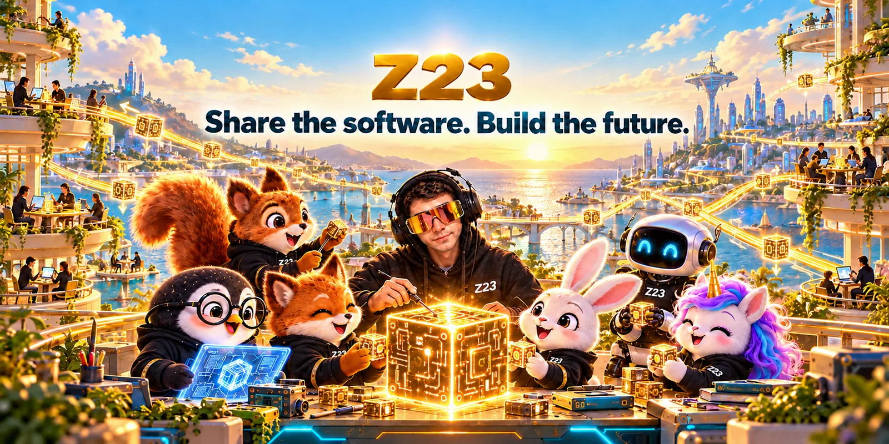

<!-- Copyright 2026 Rhett Creighton. Licensed under Apache-2.0. -->

<p align="center">
  
</p>

<p align="center">
  <b>Your own ZClassic full node and C23 software lab, in one program<br>
  you build from source and run on your own machine.</b>
</p>

<p align="center">
  <a href="#start-here">Start here</a> ·
  <a href="#your-first-lab">Your first lab</a> ·
  <a href="#join-in">Join in</a> ·
  <a href="docs/README.md">Docs</a> ·
  <a href="https://t.me/z23_chat">Chat</a>
</p>

<a id="north-star"></a>

## Why Z23

We're building Z23 toward a lab that helps improve itself: free software you
can inspect, change, and share. Every part answers to the person running it,
not to an AI vendor, a package registry, or a hosted service.

<table>
  <tr>
    <td width="33%"></td>
    <td width="33%"></td>
    <td width="33%"></td>
  </tr>
  <tr>
    <td>A full ZClassic node that checks every block itself, down to the
    zero-knowledge proofs, and keeps your private wallet. ZCL is money for
    paying and being paid, not an investment.</td>
    <td>Write one C file; Z23 runs it in a sandbox, tests it, and signs it
    as a plugin.</td>
    <td>Send source to other nodes. Whatever you fetch is rebuilt and
    re-tested on your machine and kept only if you accept it.</td>
  </tr>
</table>

You and any AI you choose use the same commands. An AI can propose, build
and test; it never holds your keys or decides what you accept. Z23 is
pre-v1: ready to build, run and inspect, not finished.
[MVP](docs/quality/MVP.md) tracks the eight v1 criteria with their evidence.

## Start here

```bash
git clone --recurse-submodules https://github.com/z23c/z23.git
cd z23
make doctor                                 # what this machine still needs
make -j"$(getconf _NPROCESSORS_ONLN)" z23   # builds build/bin/z23
build/bin/z23                               # start the node (leave it running)
build/bin/z23 status                        # in a second terminal: how it is doing, and what to do next
```

You need gcc 14+ (or clang with `-std=c23`) and GNU make. The first build
fetches pinned sources and checks each one's SHA-256; after that it builds
offline. macOS, Windows and the rest are in
[Getting Started](docs/node/GETTING_STARTED.md). For an experimental Android app, see
[Android ARM64](docs/dev/ANDROID.md).

## Try an app

Sky Combat is a flight game included in app-capable Z23 releases. On Linux
x86_64 with glibc 2.38 or newer, use the pinned installer and release below.
This installs apps without a node service. The two SHA-256 values below are
recorded here; check them against a trusted copy of this guide before use.

```sh
(
    set -eu
    installer_sha=d2f9977e024c5ece9a2dd1e55e641e5cf45fac19746d19994f1be2cf745c27f7
    manifest_sha=97442fa341dc597cd33377f469319892950dc2807e0f0c883d5831dcc670d198
    install_tmp=$(mktemp -d) || exit 1
    trap 'rm -rf -- "$install_tmp"' 0
    curl --fail --silent --show-error --location --connect-timeout 10 --max-time 90 --max-filesize 1048576 \
      "https://z23.sh/release/installers/$installer_sha/install_z23.sh" -o "$install_tmp/install_z23.sh" || exit 1
    printf '%s  %s\n' "$installer_sha" "$install_tmp/install_z23.sh" | sha256sum --check --status || exit 1
    bash "$install_tmp/install_z23.sh" --apps \
      --source="https://z23.sh/release/apps/linux-x86_64/$manifest_sha" \
      --manifest-sha256="$manifest_sha" || exit $?
)
```

For other platforms, or if you already have an app-capable release directory,
use its verified installer with `--apps --source=/absolute/path/to/app-release`.
The source build path is described above and in the platform guides.
The installer verifies the release and prints a command to
open the game. Linux desktop registration needs `update-mime-database`; if it
is unavailable, the installer reports a command-line fallback.

Open Sky Combat using the command printed by the installer to try the game.
To change it, open My Apps with the installed executable; if `z23` is not
on your PATH, replace it below with its absolute installed path:

```sh
z23 app library --datadir="$HOME/.local/share/z23-app-data"
```

Select Sky Combat and choose **Change with your AI**. Press **C** to copy the
setup into your assistant's local MCP settings, keeping the window open while
pasting. Use the command and arguments literally; they bind your assistant to
the same app-data directory. For a fresh installation, ask the assistant to
call `apps_adopt` with `name: "skycombat"`. Review **Make my copy**, then use
the offered **Build and preview** and **Keep this version** choices. Canceling
any step does not mean a version was kept.

After that first Keep, your assistant can continue using the kept-copy receipt
and verify its source; you do not need to copy the setup again. If the receipt
is missing or the copy has changed, return to My Apps, select the kept copy,
and choose **Change with your AI** (or **Change → Change with your AI**).
Press **C** and give that fresh setup to your connected assistant, keeping the
window open while pasting. Use this setup path for an existing or received copy
as well. Ask it to change your copy; review and preview the exact saved draft,
then explicitly choose **Keep this version**.
Your previous kept version remains available until you approve the new one.

To send that kept version, choose **Share this version → Share a link**, review
its identity and confirm **Share link**. Copy the link once available and keep
the sharing window open while your friend receives it; sharing stops when the
window closes or you stop it. You can instead choose **Create share file** and
send the resulting file. Sharing requires a personal publishing identity; a
received copy may open **Prepare a personal copy?**. Review and approve that
preparation, review the draft, choose **Build and preview**, then explicitly
**Keep this version**. Choose Share again to sign and share the kept version.
This onward-sharing flow does not require an AI assistant or the original
sender to remain online.

Your friend needs their own app-capable installation and desktop, not a source
checkout or a running node. For a link, they choose **Discover apps → Open a
shared app**, paste it, review the publisher and offer, then confirm **Receive**.
For a file, they can use the registered **Open With Z23** entry on Linux or run
`z23 app receive --file=/absolute/path/app.z23share --datadir="$HOME/.local/share/z23-app-data" --preview`.
Receiving, **Build and preview**, and **Keep this version** are separate choices.
Compare the publisher identity through a separate trusted channel. Link opening
and sharing currently refuse on Windows.

A graphical desktop and an available build toolchain are needed for previews.
An app-capable Linux release may include a verified compiler kit; otherwise use
GNU make and a C23-capable host compiler. See
[Try, change and share an app](docs/commons/PLUGIN_APPS.md#try-change-and-share-an-app)
for setup and platform details, and [Sky Combat](docs/commons/GAME.md) for controls.

<!-- claim: symbol-present install_app_desktop tools/scripts/install_z23.sh # app-only installation and Linux desktop registration -->
<!-- claim: symbol-present al_setup_identity tools/command/native_app_library_command.c # copied local AI setup binds the selected app -->
<!-- claim: symbol-present app_host_flow tools/command/native_app_host_flow.c # explicit share-link confirmation -->
<!-- claim: symbol-present app_network_open_link tools/command/native_app_network_controller.c # explicit link receive -->

Bare `build/bin/z23` uses the default ports and data directory and starts
syncing mainnet. To run a node beside other work, or just to look around,
give it its own data directory and ports:

```bash
build/bin/z23 -datadir="$HOME/.zclassic-c23-dev" -port=8035 -rpcport=18234 \
    -fsport=18035 -httpsport=8445
build/bin/z23 -datadir="$HOME/.zclassic-c23-dev" -rpcport=18234 stop   # when done
```

To publish a package for everyone rather than one friend, see the
[Commons quickstart](docs/commons/C23_COMMONS_QUICKSTART.md).

## Connect your AI to a local app

Follow [Try, change and share an app](docs/commons/PLUGIN_APPS.md#try-change-and-share-an-app)
to connect your AI client to the installed local stdio MCP server, using the
same persistent app data directory as your CLI commands. Local apps need no
repository checkout, running node or blockchain sync. The
[shipped app guide](platform/packaging/release/AGENT_CARD.md#connect-your-ai-to-a-local-app)
lists the graphical desktop and compiler requirements for Linux and macOS.

Then ask your AI:

> Open the flight game. Help me make my own copy, change its appearance,
> preview the saved version, keep it if I approve, and share it with a friend.

Making a personal copy and sharing require your local native confirmation.

<!-- claim: symbol-present zcl_mcp_serve_main tools/mcp/mcp_serve.c # local stdio app adapter -->
<!-- claim: symbol-present SKYCOMBAT_GAME_MAIN apps/skycombat/skycombat.mk # maintained game entrypoint -->

## Run a node

```bash
build/bin/z23
```

The node joins the network over its built-in Tor and serves its own block
explorer on its own `.onion` address. If sync stalls,
`build/bin/z23 core sync diagnose` says why and `ops logs` shows recent
diagnostics. Faster first syncs: [Sync](docs/node/SYNC.md).

## Your first lab

```bash
cat > hello.c <<'EOF'
#include <stdio.h>
int main(void) { puts("hello, lab"); return 0; }
EOF
build/bin/z23 lab run hello.c
```

`lab run` builds the file as strict C23 (with sanitizers when your compiler
has them), runs it in a private sandbox with no network, and keeps a
receipt. `lab test` checks it against your cases, and `lab promote` signs it
as a plugin. `build/bin/z23 discover help lab` lists the rest.

<!-- claim: symbol-present lab.run engine/composition/commands/lab.def # live one-file lab leaf -->
<!-- claim: symbol-present lab.test engine/composition/commands/lab.def # live lab cases leaf -->
<!-- claim: symbol-present lab.promote engine/composition/commands/lab.def # live lab-to-plugin leaf -->

## Join in

<p align="center">
  
</p>

Z23 improves itself in the open: AI workers propose changes, a different
model reviews each one, and only changes with evidence land. Take the same
small tasks, with or without your own AI.

- **Pick a task:** `build/bin/z23 card` lists starter tasks, and
  [CONTRIBUTING](.github/CONTRIBUTING.md) shows how to submit one.
- **Change the code:** `make dev-bin` builds fast,
  `make t-list` lists every registered group, and
  `make t-fast ONLY=<group>` runs one.
  `build/bin/z23 discover help` walks the native command registry.
- **Go deeper:** [How the node works](docs/node/HOW_THE_NODE_WORKS.md) ·
  [The C23 Commons](docs/commons/C23_COMMONS_QUICKSTART.md) ·
  [Vision](docs/agent/VISION.md) · [Developing](docs/dev/DEVELOPING.md) ·
  [AGENTS.md](AGENTS.md)
- **Talk to us:** [Z23 Chat on Telegram](https://t.me/z23_chat)

<!-- claim: symbol-present work.list engine/composition/commands/work.def # card alias leaf -->

## License

100% permissive: [Apache-2.0](LICENSE), with upstream notices kept in
[NOTICE](NOTICE).
