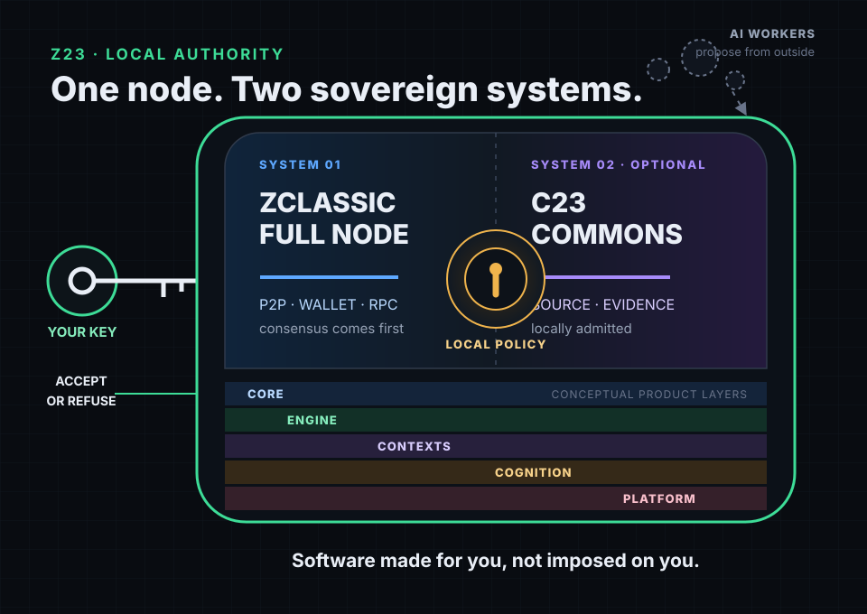
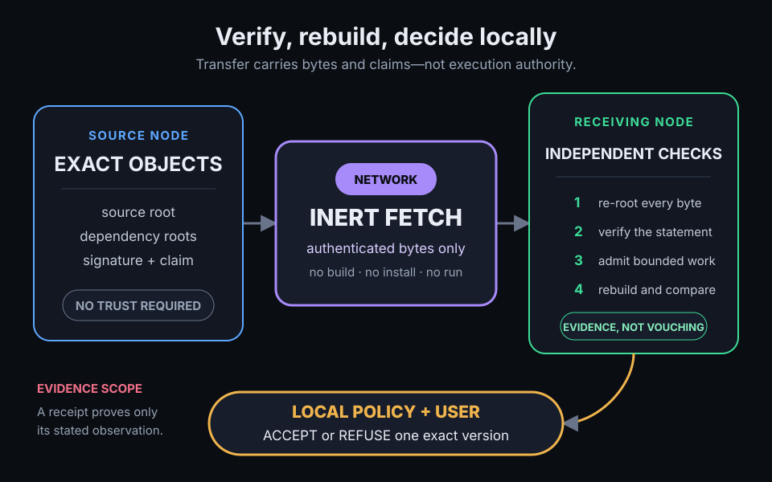
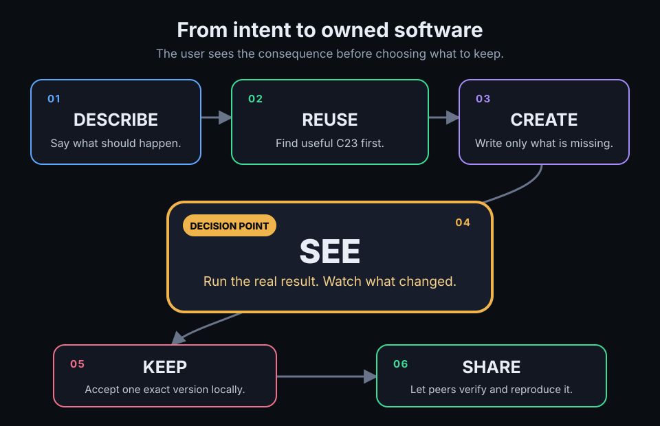

<!-- Copyright 2026 Rhett Creighton. Licensed under Apache-2.0. -->


# Z23

*Own your money. Command your machines. Build your world.*\
*Use ZCL. Build free software. Share the fire.*

**Your own ZClassic full node and C23 software lab, in one program you build
from source and run on your own machine.**

Z23 is one self-contained program written in C23, the 2023 edition of the C
language. It is a full node for ZClassic, a Zcash-derived cryptocurrency with
private ("shielded") payments. It downloads the blockchain from peers and
checks every block itself, from proof-of-work and scripts to the
zero-knowledge proofs behind shielded payments, instead of trusting a server
to have done it. It keeps your transparent and shielded wallet, answers RPC,
and serves its own block explorer on its own onion address.

The same program is a laboratory for C23 software. It compiles and runs one
file in a sandbox and keeps a receipt of what happened, turns a file that
passes its tests into a signed plugin, and shares source with other nodes
through the C23 Commons, where anything you fetch is rebuilt and re-tested on
your machine and kept only when you accept that exact version. Every part
answers to the person running it, not to an AI vendor, a package registry, or
a hosted service.

> **Status: pre-v1.** Z23 is ready to build, run, and inspect; it is not a
> finished product. Version 1 of the public node is defined by eight pass/fail
> acceptance criteria: install, onion bootstrap in under a minute, cold-start
> sync in under ten minutes, receiving a shielded payment, selling a file
> through the built-in store, seven days of running with no operator
> intervention, recovery from `kill -9`, and consensus parity with `zclassicd`,
> the original C++ ZClassic client. They are not all met yet.
> [`docs/quality/MVP.md`](docs/quality/MVP.md) records each one with its evidence, failed runs
> included. For the current count, ask a running node rather than this page:
> `build/bin/z23 milestone`.

<a id="north-star"></a>

## 🔥 Your future should belong to you

Imagine owning a laboratory that turns your ideas into working software and
helps improve itself. Connect it to thousands of other labs, and every
invention one of them shares gives the next person more to build with.

That is the Z23 vision: private money, intelligence you direct, and software
you can own, change, and pass on. The intelligence is whichever AI you choose:
Astra, Claude, or another. Z23 is the machine. ZCL is the currency of the world
we are building.

We use ZCL and build free software because we want that future to exist: tools
that let people trade, create, organize, and earn on their own terms. Every
useful contribution puts another piece of it in someone's hands.

### What works today

- **Own your money.** ZCL is private, shielded money you hold on your own
  node, for paying and being paid. It is not a promise of value. The node
  checks every block itself and shares one network with `zclassicd`.
- **Command your machines.** You at a terminal and any AI you direct use the
  same commands: the command line and the MCP server are two views of one
  command registry. An AI may search, propose, build and test; it never holds
  authority over your node, your keys, or what you accept.
- **Build your world.** One file grows along one path. `lab run` shows that it
  works, `lab test` checks it against its cases, `lab promote` signs it as a
  plugin, and the Commons lets another lab rebuild it and reproduce the result.
- **Share the fire.** Z23 improves itself in the open: AI workers propose its
  changes, a different reviewer checks each one, and only changes with
  evidence land. Volunteers take the same small tasks, each sized for the AI
  that takes it; see [Contribute](#contribute).

<!-- claim: symbol-present lab.run engine/composition/commands/lab.def # live one-file lab leaf -->
<!-- claim: symbol-present lab.test engine/composition/commands/lab.def # live lab cases leaf -->
<!-- claim: symbol-present lab.promote engine/composition/commands/lab.def # live lab-to-plugin leaf -->



For how the node, the commons, the emulated machine and the tunnels fit
together, and which parts are on main, a candidate, an experiment or still a
target, see [the whole picture](docs/commons/WHOLE_PICTURE.md).

## Choose your path

| You want to | Start here | Then read |
| --- | --- | --- |
| Run your own ZClassic node | [Start here](#start-here), then [Run a node](#run-a-node) | [Getting Started](docs/node/GETTING_STARTED.md) |
| Turn an idea into working C23 | [Your first lab](#your-first-lab) | [Development system vision](docs/agent/VISION.md) |
| Reach the chain tip sooner | [Reaching the chain tip](#reaching-the-chain-tip) | [Sync](docs/node/SYNC.md) |
| Share and reuse C23 source | [The C23 Commons](#the-c23-commons) | [Commons Quickstart](docs/commons/C23_COMMONS_QUICKSTART.md) |
| Change Z23 itself | [Working on Z23 itself](#working-on-z23-itself) | [Developing](docs/dev/DEVELOPING.md) |
| Contribute, with or without an AI | [Contribute](#contribute) | [CONTRIBUTING.md](.github/CONTRIBUTING.md) |
| Operate a fleet of machines | [Fleet guide](docs/agent/FLEET.md) | [AGENTS.md](AGENTS.md) |

## Start here

```bash
git clone --recurse-submodules https://github.com/z23c/z23.git
cd z23
make doctor-env    # can this compiler build C23?
make doctor        # what this host still needs, with the command that installs it
make setup         # arm this clone's git hooks and write compile_commands.json
make -j"$(getconf _NPROCESSORS_ONLN)" z23 # first run fetches and checksum-verifies pinned sources
build/bin/z23 discover help    # the program lists its own commands
```

On Linux that needs `gcc` 14+ (or `clang` with working `-std=c23`), GNU
`make`, a C++ compiler, and the usual fetch and checksum tools. There is no
Rust toolchain and no Rust library anywhere in the tree: shielded proving and
verification are native C23. You do not need the Zcash proving parameters to
sync and validate, because the verifying keys are compiled in; you need them
only to *send* shielded. The first build fetches pinned third-party sources,
verifies each against a pinned SHA-256, and compiles them locally; after that,
builds are offline. Prerequisites in full, macOS, Windows, and the
container-free `make portable` build are in
[Getting Started](docs/node/GETTING_STARTED.md).

## Run a node

```bash
build/bin/z23
```

The node starts on `~/.zclassic-c23` with P2P on `8033` and RPC on `18232`. A
fresh datadir starts honestly empty: `getblockcount` returns `0` until real
state lands, never a phantom tip. `build/bin/z23 status` reports readiness and
the one next action worth taking; when sync stops,
`build/bin/z23 core sync diagnose` says why and `ops logs --pattern='<regex>'`
returns bounded diagnostics. To survive logout and reboot, use the shipped
`systemd --user` unit:

```bash
sudo bash platform/deploy/setup.sh
systemctl --user start z23-node
```

**Tor is bundled, and it is on.** A plain `make` builds the pinned embedded Tor
and links it, so the node reaches the onion network and publishes its own
`.onion` with no flag; `-no-tor` is the opt-out. Resolving no hostnames is
deliberate and permanent: the first boot prints `dns_seeds=0` because this
project trusts no DNS seeder and no certificate authority. The compiled seeds
are raw addresses plus onion directory nodes; peers gossip the rest.

The node is also its own web server, with no reverse proxy in front of it. The
explorer (`/explorer`, JSON API under `/api`) is served on the node's `.onion`
by default; add a certificate and key under the datadir's `ssl` directory and it
also serves HTTPS on `8443` near tip
([runbook](docs/BLOCK_EXPLORER_HOSTING.md)).

## Your first lab

The lab needs only the binary you just built. Write one C file and run it:

```bash
cat > hello.c <<'EOF'
#include <stdio.h>

int main(void)
{
    char name[64];
    if (!fgets(name, sizeof name, stdin))
        return 1;
    printf("hello, %s\n", name);
    return 0;
}
EOF
build/bin/z23 lab run hello.c --stdin=world
```

`lab run` compiles the file as strict C23, with AddressSanitizer and
UndefinedBehaviorSanitizer when your compiler has them, runs it in a fresh
private directory with no network and no fork, and answers with the exit code,
the output, any sanitizer findings and a receipt. An identical request is
answered from that receipt without running again; `--fresh` runs it anew.
Where the sandbox cannot be applied, it refuses rather than run your program
unconfined.

From there the same file goes further:

```bash
build/bin/z23 lab test solve.c --cases=cases.json
build/bin/z23 lab promote upper.c --cases=cases.json --name=upper --version=1.0.0 --key=./publisher.key --dir=./dist
```

`lab test` runs a list of input cases against one build and reports pass or
fail with a diff for each. `lab promote` runs those cases again on a fresh
sanitized build and signs the file as a one-shot plugin only when every case
passes. Each command answers an AI exactly as it answers you, so an agent can
drive the whole loop; `build/bin/z23 discover help lab` lists the family.

## Reaching the chain tip

**Full P2P sync from genesis** is the default and needs nothing you do not
already have; it is what `build/bin/z23` with no flags does. It is also the
slowest, because it validates the chain itself: proof-of-work, scripts, and
shielded proofs. Headers arrive quickly, bodies are the long pole, and a full
run takes hours. Choose it for state that is entirely self-derived.

**A peer's signed state offer** makes a first sync short without making it
credulous. Peers append a bundle height, digest, and producer to the handshake;
your node picks the newest offer within 576 blocks of that peer's own tip,
verifies each chunk before import, and installs it against the checkpoint
compiled into your own binary, with no flag from you. If nothing acceptable
arrives within two minutes of your first peer, the node names
`bootstrap.stale_offers_only`, prints the newest height it did see, and folds
from genesis rather than dropping back silently. That machinery is built and
code-tested; a full fresh z23-to-z23 run to tip is not yet the proven everyday
path.

**Import from an existing `zclassicd` datadir**, if you already run the legacy
C++ node, is today's proven cold start. Headers first, then a normal boot;
skipping the first step leaves a header hole and the node pins.

```bash
build/bin/z23 --importblockindex "$HOME/.zclassic"
build/bin/z23
```

Naming a peer you already know shortens any of these: `-addnode=HOST:8033`,
plus `-fileservice=HOST` to pull the header seed and state bundle from that
host's file service. Every path, with its measured evidence, is in
[Sync](docs/node/SYNC.md).

| Path | You need | Time to tip | Standing |
| --- | --- | --- | --- |
| Full P2P sync from genesis | nothing extra | hours | the default |
| A peer's signed state offer | a peer with a fresh offer | short | built and code-tested; not yet the proven everyday path |
| Import from `zclassicd` | an existing legacy datadir | short | today's proven cold start |

## Consensus parity is the inviolable target

Z23 shares one network with the legacy `zclassicd` clients: same P2P protocol,
same blocks, and consensus divergence is a defect rather than a feature. A
read-only parity service diffs the UTXO set and tip against a local `zclassicd`
oracle whenever one resolves, and a from-genesis replay canary re-validates full
history through the current reducer. Both are criterion 8, with their standing
verdicts, in [`docs/quality/MVP.md`](docs/quality/MVP.md).

## The C23 Commons

The same binary carries a commons for C23 software: content-addressed source
and packages, authenticated fetch of inert bytes, bounded build and test work,
and receipts another machine can re-check. The authority boundaries are the
point. Fetching bytes does not authorize building them, building does not
authorize installation, execution, or deployment, and chain work always has
priority over package work.



AI workers may search, propose, build, and test. They do not become a source of
truth, because what Z23 keeps is what another machine can check without them. A
hash identifies exact bytes; a signature identifies the key that made a
statement; a receipt records one bound observation. None of them alone shows
that arbitrary code is safe, correct, or useful, so acceptance stays a local
decision about one exact version. The durability test is blunt: the original
worker, publisher, or company can disappear, and the accepted source and
evidence can still be checked and reproduced here. Start at
`build/bin/z23 zcode guide`.

## Working on Z23 itself

The native command registry is generated from the running program, so no
document can drift away from it. Descend with `discover help <path>`, search
with `discover search <query>`, and read a leaf's exact input keys with
`discover schema <leaf>`. The source tree answers the same way; ask it instead
of grepping it, and ask it which tests own the file you touched:

```bash
build/bin/z23 code map
build/bin/z23 code room engine/reducer/services/src/reducer_ingest_service.c
build/bin/z23 code tests engine/reducer/services/src/reducer_ingest_service.c
make -j"$(getconf _NPROCESSORS_ONLN)" t-fast ONLY=<group>
```

`make t-list` lists every registered group, `ONLY=` is mandatory for `t-fast`,
and `make test-parallel` runs the whole set. While editing, `make dev-bin`
relinks the fast non-LTO `build/bin/z23-dev` and `make lint-fast` gives
feedback; publishing needs the full `make lint` gate set plus the impacted
groups, run in one isolated worktree against the exact commit pair and ending
in a signed receipt the pre-push hook requires, so a green push means the
evidence exists rather than that nobody looked.

The tree is authority-first: sealed consensus, crypto, and proofs in `core`,
the single chain-state-advancing room in `engine/reducer`, feature-first product
rooms in `contexts`, what the system needs from the outside world in
`platform/ports` and how an OS provides it in `platform/adapters`. Reusable
modules live beneath the authority that owns them, and the build refuses a file
placed outside its room; `build/bin/z23 code context-map` prints the view it
generates.



Building software here runs DESCRIBE → REUSE → CREATE → SEE → REPRODUCE →
ACCEPT, so seeing the consequence, and another node reproducing it, comes
before deciding to accept and use it. `zhello` is the smallest prompt-to-pixel
example, a reusable painter plus a native window, and `zdemo` is the same
package shape after customization. Headless modes render the real frames and
check deterministic digests; windowed modes put the consequence on screen.

```bash
make zhello-selftest
make zdemo ZDEMO_ARGS=--frames=2
```

## Contribute

Volunteers, including people who drive their own AI coding agents, start at
[CONTRIBUTING.md](.github/CONTRIBUTING.md): one build sequence, small public
work cards sized for the AI that takes them (`build/bin/z23 card` lists them),
and how to submit. Maintainers and fleet members continue with
[AGENTS.md](AGENTS.md).

<!-- claim: symbol-present work.list engine/composition/commands/work.def # card alias leaf -->

Questions, node reports and ideas:
join [Z23 Chat on Telegram](https://t.me/z23_chat).

## Go deeper

- **Run it:** [Getting Started](docs/node/GETTING_STARTED.md) · [Sync](docs/node/SYNC.md) · [MVP acceptance](docs/quality/MVP.md) · [Windows](docs/node/WINDOWS.md)
- **Understand it:** [How the Node Works](docs/node/HOW_THE_NODE_WORKS.md) · [Framework](docs/commons/FRAMEWORK.md) · [Development system vision](docs/agent/VISION.md) · Command reference: `make docs-api-reference` writes `build/gen/API_REFERENCE.md` (or ask `z23 discover describe <path>`)
- **Build with it:** [Developing](docs/dev/DEVELOPING.md) · [Codebase Map](docs/dev/CODEBASE_MAP.md) · [Commons Quickstart](docs/commons/C23_COMMONS_QUICKSTART.md) · [Forward Plan](docs/work/FORWARD_PLAN.md)
- **License:** [Apache-2.0](LICENSE), with upstream notices preserved in [NOTICE](NOTICE)
