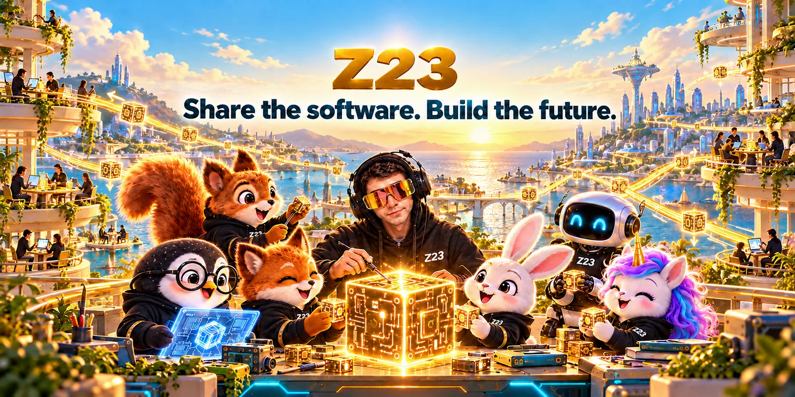
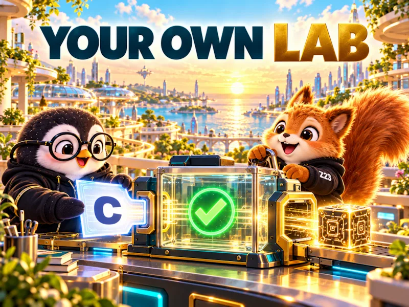

<!-- Copyright 2026 Rhett Creighton. Licensed under Apache-2.0. -->

<p align="center">
  
</p>

<p align="center">
  <b>Your own ZClassic full node and C23 software lab, in one program<br>
  you build from source and run on your own machine.</b>
</p>

<p align="center">
  <a href="#start-here">Start here</a> ·
  <a href="#your-first-lab">Your first lab</a> ·
  <a href="#join-in">Join in</a> ·
  <a href="docs/README.md">Docs</a> ·
  <a href="https://t.me/z23_chat">Chat</a>
</p>

<a id="north-star"></a>

## Why Z23

We're building Z23 toward a lab that helps improve itself: free software you
can inspect, change, and share. Every part answers to the person running it,
not to an AI vendor, a package registry, or a hosted service.

<table>
  <tr>
    <td width="33%"></td>
    <td width="33%"></td>
    <td width="33%"></td>
  </tr>
  <tr>
    <td>A full ZClassic node that checks every block itself, down to the
    zero-knowledge proofs, and keeps your private wallet. ZCL is money for
    paying and being paid, not an investment.</td>
    <td>Write one C file; Z23 runs it in a sandbox, tests it, and signs it
    as a plugin.</td>
    <td>Send source to other nodes. Whatever you fetch is rebuilt and
    re-tested on your machine and kept only if you accept it.</td>
  </tr>
</table>

You and any AI you choose use the same commands. An AI can propose, build
and test; it never holds your keys or decides what you accept. Z23 is
pre-v1: ready to build, run and inspect, not finished.
[MVP](docs/quality/MVP.md) tracks the eight v1 criteria with their evidence.

## Start here

```bash
git clone --recurse-submodules https://github.com/z23c/z23.git
cd z23
make doctor                                 # what this machine still needs
make -j"$(getconf _NPROCESSORS_ONLN)" z23   # builds build/bin/z23
build/bin/z23                               # start the node (leave it running)
build/bin/z23 status                        # in a second terminal: how it is doing, and what to do next
```

You need gcc 14+ (or clang with `-std=c23`) and GNU make. The first build
fetches pinned sources and checks each one's SHA-256; after that it builds
offline. macOS, Windows and the rest are in
[Getting Started](docs/node/GETTING_STARTED.md).

## Run a node

```bash
build/bin/z23
```

The node joins the network over its built-in Tor and serves its own block
explorer on its own `.onion` address. If sync stalls,
`build/bin/z23 core sync diagnose` says why and `ops logs` shows recent
diagnostics. Faster first syncs: [Sync](docs/node/SYNC.md).

## Your first lab

```bash
cat > hello.c <<'EOF'
#include <stdio.h>
int main(void) { puts("hello, lab"); return 0; }
EOF
build/bin/z23 lab run hello.c
```

`lab run` builds the file as strict C23 (with sanitizers when your compiler
has them), runs it in a private sandbox with no network, and keeps a
receipt. `lab test` checks it against your cases, and `lab promote` signs it
as a plugin. `build/bin/z23 discover help lab` lists the rest.

<!-- claim: symbol-present lab.run engine/composition/commands/lab.def # live one-file lab leaf -->
<!-- claim: symbol-present lab.test engine/composition/commands/lab.def # live lab cases leaf -->
<!-- claim: symbol-present lab.promote engine/composition/commands/lab.def # live lab-to-plugin leaf -->

## Join in

<p align="center">
  
</p>

Z23 improves itself in the open: AI workers propose changes, a different
model reviews each one, and only changes with evidence land. Take the same
small tasks, with or without your own AI.

- **Pick a task:** `build/bin/z23 card` lists starter tasks, and
  [CONTRIBUTING](.github/CONTRIBUTING.md) shows how to submit one.
- **Change the code:** `make dev-bin` builds fast,
  `make t-list` lists every registered group, and
  `make t-fast ONLY=<group>` runs one.
  `build/bin/z23 discover help` walks the native command registry.
- **Go deeper:** [How the node works](docs/node/HOW_THE_NODE_WORKS.md) ·
  [The C23 Commons](docs/commons/C23_COMMONS_QUICKSTART.md) ·
  [Vision](docs/agent/VISION.md) · [Developing](docs/dev/DEVELOPING.md) ·
  [AGENTS.md](AGENTS.md)
- **Talk to us:** [Z23 Chat on Telegram](https://t.me/z23_chat)

<!-- claim: symbol-present work.list engine/composition/commands/work.def # card alias leaf -->

## License

100% permissive: [Apache-2.0](LICENSE), with upstream notices kept in
[NOTICE](NOTICE).
